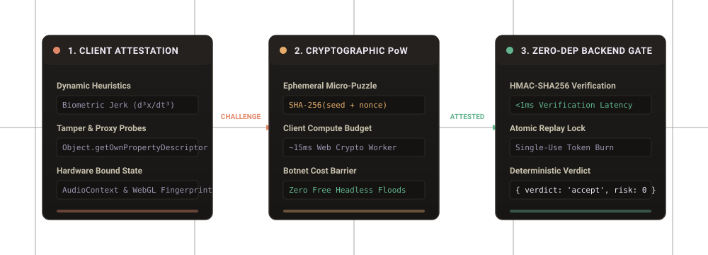

# OBSX Security Protocol

<p align="center">
  
</p>

<p align="center">
  <a href="LICENSE"></a>
  <a href="package.json"></a>
  <a href="tests/"></a>
  <a href="lib/crypto.js"></a>
  <a href="https://obsx.tech"></a>
</p>

OBSX Security is an open-core protocol for client integrity attestation, anti-automation, and tamper-resistant request verification.

It replaces fragile advisory JSON telemetry and intrusive third-party CAPTCHAs with cryptographic micro-proof-of-work, prototype-tamper auditing, biological kinematic jerk entropy, and zero-dependency backend verification.

---

## The Fundamental Flaw of Advisory Anti-Bot Telemetry

Most client anti-bot libraries rely on advisory telemetry: the client collects browser properties and posts them to a server as plain JSON.

Under real adversarial conditions, this design breaks down immediately:

1. **Empty Payload Vulnerability (`{}`)**: In traditional advisory systems, a headless script that posts an empty payload `{}` or omits telemetry receives a zero-risk verdict because no bot heuristics fired.
2. **Zero Computation Cost for Botnets**: Attackers can flood millions of requests without consuming client CPU cycles because there is no computational challenge.
3. **Web Proxy & Virtualization Blindness**: Userspace unblockers (Ultraviolet, Scramjet, Bare-mux) wrap `window.location` and standard web APIs in userspace. Advisory scripts cannot differentiate legitimate browsers from virtualized environments.
4. **Third-Party Account Lockout DoS**: Rate-limiting OTP codes by global identity (email/username) allows an attacker to lock out thousands of honest users with automated bad requests.

### How OBSX Enforces Protocol Invariants

* **Cryptographic Micro-Proof-of-Work (PoW)**: Every session requires solving an ephemeral SHA-256 micro-puzzle. Modern browsers solve it in ~15ms via Web Crypto, while automated botnets face an unsustainable hardware compute tax.
* **Mandatory Attestation**: Empty payloads (`{}`) or unattested tokens are automatically hard-rejected with Risk 100 (`missing_telemetry`).
* **Web IDL Descriptor Auditing**: Probes function property descriptors to detect `.bind()` poisoning, `Proxy` wrappers, and web unblocker shims while respecting genuine native browser accessors.
* **Kinematic Jerk Entropy ($d^3x/dt^3$)**: Evaluates natural human neuromuscular tremor; artificial linear paths and synthetic Bezier splines are flagged.
* **Subnet-Scoped Rate Limiting**: Pre-auth endpoints are rate-limited per IP subnet, eliminating third-party account lockout denial-of-service.

---

## Security & Architecture Comparison

| Capability | OBSX Security | Traditional Advisory Scripts | Legacy CAPTCHAs (Turnstile / hCaptcha) |
| :--- | :--- | :--- | :--- |
| **Proof-of-Work Challenge** | **Enforced** (~15ms SHA-256 micro-puzzle) | None (Free curl floods allowed) | Server-heavy / high latency |
| **Empty Signals (`{}`)** | **Hard Reject** (Risk 100) | Bypassed (Risk 0) | Rejected |
| **Proxy Unblockers (UV / Bare-Mux)** | **Native Web IDL Heuristics** | Blind (Unmonitored) | Easily proxied |
| **Prototype Tamper Resilience** | **Descriptor & Bound Name Probes** | Bypassed via `.bind()` | Varies |
| **Rate Limit Scoping** | **Subnet-Scoped** (No identity lockout) | Global Identity Lockout (DoS) | IP based |
| **Dependencies** | **0 (Zero)** | Multiple npm packages | Heavy proprietary blobs |
| **Memory Ceiling** | **Priority-Tiered (100k Key Cap)** | Uncapped in-memory maps | Vendor cloud |

---

## 5 Production Use Cases

### 1. AI Chat & LLM Token Protection
Protect expensive inference endpoints (OpenAI, Anthropic, local Ollama) from automated credit scraping, proxy relays, and bot draining without forcing human users to solve puzzles.

```javascript
// Client: Attest user prompt before submitting to /api/chat
const { token, nonce } = await OBSX.getAttestation();
await fetch('/api/chat', {
  method: 'POST',
  headers: { 'Content-Type': 'application/json' },
  body: JSON.stringify({ token, nonce, message: prompt })
});
```

### 2. High-Value Voucher & Promo Pool Claims
Eliminate race conditions and automated PIN brute-forcing on limited reward pools while ensuring genuine customers never hit false positive blocks.

```javascript
// Server: Verify cryptographic token & nonce before deducting voucher pool
const { verifyToken } = require('obsx-security');
const verdict = await verifyToken(req.body, { secretKey: process.env.OBSX_SECRET_KEY });
if (!verdict.allowed) {
  return res.status(403).json({ error: 'Automated claim rejected', reasons: verdict.reasons });
}
await claimVoucher(req.body.pin);
```

### 3. Authentication & Subnet-Scoped OTP Defense
Prevent SMS toll fraud and credential stuffing attacks on sign-up pages without letting an attacker lock out legitimate email accounts.

### 4. Fair Gaming Leaderboards & Micro-Voting
Detect automated macro clickers and synthetic spline scripts in competitive leaderboards through kinematic jerk ($d^3x/dt^3$) verification.

### 5. Replay-Proof Sensitive Form Endpoints
Atomic single-use token burn prevents duplicate submissions, double checkouts, and replay attacks even across distributed web nodes.

---

## Quickstarts

### 1. Browser Client SDK

#### Option A — Zero-JS Form Protection (Fastest)
Add one `<script>` tag and `data-obsx-protect` to any `<form>`. OBSX automatically resolves your API origin, solves the micro-PoW in the background, and attaches hidden `obsx-token` and `obsx-nonce` fields on submit:

```html
<script src="https://obsx.tech/obsx.min.js" data-obsx-site="pk_YOUR_SITE_KEY" defer></script>

<form action="/api/submit" method="POST" data-obsx-protect>
  <input type="email" name="email" required />
  <button type="submit">Continue</button>
</form>
```

#### Option B — Programmatic SPA / `fetch()` Integration
```html
<script src="https://obsx.tech/obsx.min.js" data-obsx-site="pk_YOUR_SITE_KEY"></script>
```

```javascript
// Collects behavioral entropy and solves the ephemeral SHA-256 micro-PoW (~15ms)
const { token, nonce } = await OBSX.getAttestation();

await fetch('/api/submit', {
  method: 'POST',
  headers: { 'Content-Type': 'application/json' },
  body: JSON.stringify({ token, nonce, score: 500 })
});
```

Or bind every payload field to an HMAC action seal using `OBSX.seal({ score: 500 })`.

---

### 2. Backend Verification

#### Express / Connect (1-Line Middleware)
```javascript
const express = require('express');
const obsx = require('obsx-security');

const app = express();
app.use(express.json());
app.use(express.urlencoded({ extended: false }));

app.post('/api/submit', obsx.middleware({ secretKey: process.env.OBSX_SECRET_KEY }), (req, res) => {
  res.json({ ok: true, risk: req.obsx.risk });
});
```

#### Node.js (`verifyToken` Manual Control)
```javascript
const { verifyToken } = require('obsx-security');

app.post('/api/submit', async (req, res) => {
  const result = await verifyToken(req.body, {
    secretKey: process.env.OBSX_SECRET_KEY,
    clientUa: req.headers['user-agent']
  });

  if (!result.allowed) {
    return res.status(403).json({ ok: false, reasons: result.reasons });
  }

  res.json({ ok: true, message: 'Verified' });
});
```

#### Next.js (App Router Route Handler)
```typescript
import { NextResponse } from 'next/server';
import { verifyToken } from 'obsx-security';

export async function POST(request: Request) {
  const body = await request.json();

  const result = await verifyToken(body, {
    secretKey: process.env.OBSX_SECRET_KEY!,
    clientUa: request.headers.get('user-agent') || undefined
  });

  if (!result.allowed) {
    return NextResponse.json({ ok: false, reasons: result.reasons }, { status: 403 });
  }

  return NextResponse.json({ ok: true });
}
```

#### Python (FastAPI — HTTP Verification API)
```python
from fastapi import FastAPI, HTTPException, Request
import httpx
import os

app = FastAPI()

@app.post("/api/submit")
async def submit(request: Request):
    body = await request.json()
    async with httpx.AsyncClient(timeout=5.0) as client:
        resp = await client.post(
            "https://obsx.tech/api/v1/verify",
            headers={
                "Authorization": f"Bearer {os.environ['OBSX_SECRET_KEY']}",
                "X-OBSX-Client-UA": request.headers.get("user-agent", ""),
            },
            json={
                "token": body.get("token") or body.get("obsx-token"),
                "nonce": body.get("nonce") or body.get("obsx-nonce"),
            },
        )
    verdict = resp.json() if resp.status_code == 200 else {"allowed": False, "reasons": ["verify_failed"]}
    if not verdict.get("allowed"):
        raise HTTPException(status_code=403, detail=verdict.get("reasons", []))
    return {"ok": True}
```

---

## Kerckhoffs's Principle: 100% Open-Source Security

> *"A cryptosystem should be secure even if everything about the system, except the key, is public knowledge."*  
> — **Auguste Kerckhoffs (1883)**

Most anti-bot products rely on security through obscurity: obfuscating JavaScript variables, hiding regex heuristics, and checking static build fingerprints. The moment an attacker inspects the code, the security evaporates.

**OBSX Security was engineered specifically for public open-source transparency:**

* **Mathematical Guarantees Over Secret Code**: Knowing our SHA-256 micro-puzzle solver does not allow an attacker to bypass it. The computational hardware cost must still be paid.
* **Physics Over Heuristics**: Knowing our 3rd-derivative kinematic jerk evaluation ($d^3x/dt^3$) does not allow a headless bot to fabricate human neuromuscular tremor.
* **Zero Client-Side Secrets**: Private HMAC keys (`sk_live_...`) never touch client browsers.
* **Zero External Dependencies**: Pure native Node.js `crypto` on the server and native Web Crypto in the browser. Zero third-party telemetry leakage.

---

## Local Development & Testing

```bash
# Clone repository
git clone https://github.com/jidiotspam-hue/obsx.git
cd obsx

# Build client SDK bundles
npm run build

# Run comprehensive test suite
npm test

# Start local server
npm start
# -> Running on http://localhost:3000
```

Explore the live interactive sandbox, test simulated bot attacks in the **[OBSX Secure Notes Demo](https://obsx.tech/notes.html)**, and inspect the real-time telemetry stream directly on the production node at **[https://obsx.tech](https://obsx.tech)**.

---

## License

Dual-licensed under the **MIT License** (Zone 1: Core Protocol Engine, Client SDK, Tests & Public Docs) and **Elastic License 2.0 + Additional OBSX Zone 2 Terms** (Zone 2: Operator Server, Dashboard, Origin Shield, Auto-Updater & Accounts/Mailer):

- **Prospective Applicability & Prior Releases**: The updated Dual License governs **v2.2.0 onward**. Earlier commits distributed solely under MIT retain MIT terms for those historical versions, while v2.2.0+ releases and upgrades incorporating Zone 2 modules follow [LICENSE](LICENSE).
- **Zone 1 (Core Protocol, SDK & Docs)**: Permissive MIT — free for anyone to embed, verify, and build upon.
- **Zone 2 (Operator Dashboard, Shield, Updater & Scaffolding)**: Source-available under ELv2 + OBSX Zone 2 terms (`server.js`, `lib/botshield.js`, `lib/updater.js`, `lib/accounts.js`, `lib/mailer.js`, `tools/flood.js`, `public/dashboard.*`). Free to run and modify internally for self-hosted infrastructure; hosted SaaS redistribution and extraction into competing products are prohibited.
- **Proprietary & Closed-Source (Sentinel™)**: The **OBSX Sentinel™ Adaptive Vector Circuit Breaker Engine** is **strictly closed source and proprietary**, maintained separately in `obsx-sentinel` for [obsx.tech](https://obsx.tech), and is not licensed under MIT or ELv2.

See the full [LICENSE](LICENSE) file for complete legal terms and zone mappings.
