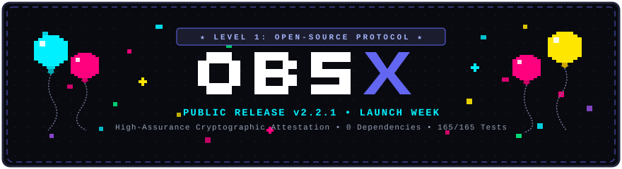
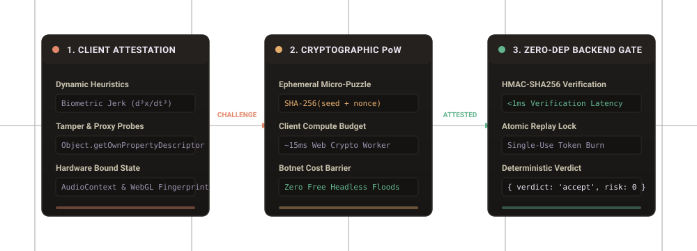

# OBSX Security Protocol

<p align="center">
  
</p>

```text
╭───────────────────────────────────────────────────────────────────╮
│  * * *  OBSX PROTOCOL v2.2.0 • WORLD PREMIERE LAUNCH  * * *       │
│                                                                   │
│  STAGE 1: DEFEAT ADVISORY BOTS        [ CLEARED • 100% BLOCKED ]  │
│  DIFFICULTY: CRYPTOGRAPHIC HARD       [ SHA-256 MICRO-POW ]       │
│  PARTY MEMBERS: ZERO RUNTIME DEPS     [ 100% PURE NATIVE NODE ]   │
│  STATUS: 81 / 81 TESTS PASSING        [ ALL SYSTEMS GREEN ]       │
│  LIVE NODE: OBSX.TECH                 [ PRODUCTION OPERATIONAL ]  │
╰───────────────────────────────────────────────────────────────────╯
```

<p align="center">
  <a href="LICENSE"></a>
  <a href="tests/"></a>
  <a href="package.json"></a>
  <a href="LICENSE"></a>
  <a href="https://obsx.tech"></a>
</p>

### [Launch Week Milestone]

OBSX is officially open-source! We built this protocol to prove that high-assurance client attestation doesn't require intrusive third-party CAPTCHAs, bloated vendor SDKs, or fragile advisory client JSON.

- **0 Runtime Dependencies**: Pure Node.js standard library (`crypto`, `http`, `fs`).
- **Client SDK Footprint**: 24.2 KB uncompressed (7.8 KB gzip) with Web Crypto.
- **Sub-Millisecond Verification**: Local token decryption and verification in <1ms.
- **Full Attack Resistance**: Validated under saturation blitzes with zero leaked memory.
- **Origin Shield**: tiered L7 flood control that engages under attack and stands down when quiet (`lib/botshield.js`).

<p align="center">
  
</p>

OBSX Security is the open-source protocol for client integrity attestation, anti-automation, and tamper-resistant request verification.

It replaces fragile advisory JSON telemetry and intrusive third-party CAPTCHAs with cryptographic micro-proof-of-work, prototype-tamper auditing, biological kinematic jerk entropy, and zero-dependency backend verification.

---

## The Fundamental Flaw of Advisory Anti-Bot Telemetry

Most client anti-bot libraries rely on advisory telemetry: the client collects browser properties and posts them to a server as plain JSON.

Under real adversarial conditions, this design breaks down immediately:

1. **Empty Payload Vulnerability (`{}`)**: In traditional advisory systems, a headless script that posts an empty payload `{}` or omits telemetry receives a zero-risk verdict because no bot heuristics fired.
2. **Zero Computation Cost for Botnets**: Attackers can flood millions of requests without consuming client CPU cycles because there is no computational challenge.
3. **Web Proxy & Virtualization Blindness**: Userspace unblockers (Ultraviolet, Scramjet, Bare-mux) wrap `window.location` and standard web APIs in userspace. Advisory scripts cannot differentiate legitimate browsers from virtualized environments.
4. **Third-Party Account Lockout DoS**: Rate-limiting OTP codes by global identity (email/username) allows an attacker to lock out thousands of honest users with automated bad requests.

### How OBSX Enforces Protocol Invariants

* **Cryptographic Micro-Proof-of-Work (PoW)**: Every session requires solving an ephemeral SHA-256 micro-puzzle. Modern browsers solve it in ~15ms via Web Crypto, while automated botnets face an unsustainable hardware compute tax.
* **Mandatory Attestation**: Empty payloads (`{}`) or unattested tokens are automatically hard-rejected with Risk 100 (`missing_telemetry`).
* **Web IDL Descriptor Auditing**: Probes function property descriptors to detect `.bind()` poisoning, `Proxy` wrappers, and web unblocker shims while respecting genuine native browser accessors.
* **Kinematic Jerk Entropy ($d^3x/dt^3$)**: Evaluates natural human neuromuscular tremor; artificial linear paths and synthetic Bezier splines are flagged.
* **Subnet-Scoped Rate Limiting**: Pre-auth endpoints are rate-limited per IP subnet, eliminating third-party account lockout denial-of-service.

---

## Security & Architecture Comparison

| Capability | OBSX Security | Traditional Advisory Scripts | Legacy CAPTCHAs (Turnstile / hCaptcha) |
| :--- | :--- | :--- | :--- |
| **Proof-of-Work Challenge** | **Enforced** (~15ms SHA-256 micro-puzzle) | None (Free curl floods allowed) | Server-heavy / high latency |
| **Empty Signals (`{}`)** | **Hard Reject** (Risk 100) | Bypassed (Risk 0) | Rejected |
| **Proxy Unblockers (UV / Bare-Mux)** | **Native Web IDL Heuristics** | Blind (Unmonitored) | Easily proxied |
| **Prototype Tamper Resilience** | **Descriptor & Bound Name Probes** | Bypassed via `.bind()` | Varies |
| **Rate Limit Scoping** | **Subnet-Scoped** (No identity lockout) | Global Identity Lockout (DoS) | IP based |
| **Dependencies** | **0 (Zero)** | Multiple npm packages | Heavy proprietary blobs |
| **Memory Ceiling** | **Priority-Tiered (100k Key Cap)** | Uncapped in-memory maps | Vendor cloud |

---

## 5 Production Use Cases

### 1. AI Chat & LLM Token Protection
Protect expensive inference endpoints (OpenAI, Anthropic, local Ollama) from automated credit scraping, proxy relays, and bot draining without forcing human users to solve puzzles.

```javascript
// Client: Attest user prompt before submitting to /api/chat
const attestation = await OBSX.verify({ promptLen: prompt.length });
await fetch('/api/chat', {
  method: 'POST',
  headers: { 'Content-Type': 'application/json' },
  body: JSON.stringify({ token: attestation.token, message: prompt })
});
```

### 2. High-Value Voucher & Promo Pool Claims
Eliminate race conditions and automated PIN brute-forcing on limited reward pools while ensuring genuine customers never hit false positive blocks.

```javascript
// Server: Verify cryptographic token before deducting voucher pool
const verdict = await verifyToken(req.body.token, { secret: process.env.OBSX_SECRET });
if (verdict.verdict === 'reject') {
  return res.status(403).json({ error: 'Automated claim rejected' });
}
await claimVoucher(req.body.pin);
```

### 3. Authentication & Subnet-Scoped OTP Defense
Prevent SMS toll fraud and credential stuffing attacks on sign-up pages without letting an attacker lock out legitimate email accounts.

### 4. Fair Gaming Leaderboards & Micro-Voting
Detect automated macro clickers and synthetic spline scripts in competitive leaderboards through kinematic jerk ($d^3x/dt^3$) verification.

### 5. Replay-Proof Sensitive Form Endpoints
Atomic single-use token burn prevents duplicate submissions, double checkouts, and replay attacks even across distributed web nodes.

---

## Quickstarts

### 1. Browser Client SDK

Add the official lightweight SDK to your page:

```html
<script src="https://obsx.tech/obsx.min.js" data-obsx-site="pk_YOUR_SITE_KEY"></script>
```

When a user triggers a protected action:

```javascript
// Solves ephemeral PoW and harvests biometric attestation (~15ms)
const attestation = await OBSX.verify({ action: 'submit_score' });

if (attestation.verdict === 'accept') {
  // Send single-use token with your request
  await fetch('/api/submit', {
    method: 'POST',
    headers: { 'Content-Type': 'application/json' },
    body: JSON.stringify({ token: attestation.token, score: 500 })
  });
}
```

---

### 2. Backend Verification

#### Node.js (Native `http` / Express)
```javascript
const { verifyToken } = require('obsx-security');

app.post('/api/submit', async (req, res) => {
  const { token, score } = req.body;

  // Zero-dependency local verification (<1ms)
  const result = await verifyToken(token, {
    secret: process.env.OBSX_SECRET,
    clientIp: req.ip
  });

  if (result.verdict === 'reject') {
    return res.status(403).json({ ok: false, reasons: result.reasons });
  }

  res.json({ ok: true, message: 'Verified' });
});
```

#### Next.js (App Router Route Handler)
```typescript
import { NextResponse } from 'next/server';
import { verifyToken } from 'obsx-security';

export async function POST(request: Request) {
  const { token, score } = await request.json();
  const clientIp = request.headers.get('x-forwarded-for') || '127.0.0.1';

  const result = await verifyToken(token, {
    secret: process.env.OBSX_SECRET!,
    clientIp
  });

  if (result.verdict === 'reject') {
    return NextResponse.json({ ok: false, reasons: result.reasons }, { status: 403 });
  }

  return NextResponse.json({ ok: true });
}
```

#### Python (FastAPI)
```python
from fastapi import FastAPI, HTTPException, Request
from obsx import verify_token
import os

app = FastAPI()

@app.post("/api/submit")
async def submit(request: Request):
    body = await request.json()
    verdict = verify_token(
        token=body.get("token"),
        secret=os.environ["OBSX_SECRET"],
        client_ip=request.client.host
    )
    if verdict["verdict"] == "reject":
        raise HTTPException(status_code=403, detail=verdict["reasons"])
    return {"ok": True}
```

---

## Kerckhoffs's Principle: 100% Open-Source Security

> *"A cryptosystem should be secure even if everything about the system, except the key, is public knowledge."*  
> — **Auguste Kerckhoffs (1883)**

Most anti-bot products rely on security through obscurity: obfuscating JavaScript variables, hiding regex heuristics, and checking static build fingerprints. The moment an attacker inspects the code, the security evaporates.

**OBSX Security was engineered specifically for public open-source transparency:**

* **Mathematical Guarantees Over Secret Code**: Knowing our SHA-256 micro-puzzle solver does not allow an attacker to bypass it. The computational hardware cost must still be paid.
* **Physics Over Heuristics**: Knowing our 3rd-derivative kinematic jerk evaluation ($d^3x/dt^3$) does not allow a headless bot to fabricate human neuromuscular tremor.
* **Zero Client-Side Secrets**: Private HMAC keys (`sk_live_...`) never touch client browsers.
* **Zero External Dependencies**: Pure native Node.js `crypto` on the server and native Web Crypto in the browser. Zero third-party telemetry leakage.

---

## Local Development & Testing

```bash
# Clone repository
git clone https://github.com/jidiotspam-hue/obsx.git
cd obsx

# Build client SDK bundles
npm run build

# Run comprehensive test suite
npm test

# Start local server
npm start
# -> Running on http://localhost:3000
```

Explore the live interactive sandbox, test simulated bot attacks in the **[OBSX Secure Notes Demo](https://obsx.tech/notes.html)**, and inspect the real-time telemetry stream directly on the production node at **[https://obsx.tech](https://obsx.tech)**.

---

## Origin Shield: layer-7 flood control (`lib/botshield.js`)

The protocol above verifies *who* is calling. The origin shield protects the *machine that answers*. It sits in front of every request, before routing, before the page cache, before the Security Gate, and before any database or telemetry work, and it is the reason a 20-minute, 560,000-request flood against obsx.tech never reached the application.

It escalates through the cheapest defence that is working, in order:

| Tier | What it does | Cost to the origin |
| :--- | :--- | :--- |
| Self-monitoring | req/s, in-flight, RSS, event-loop lag, work latency | ~0 |
| Connection ceiling | refuse new sockets above `OBSX_HARD_CONN_CEILING` | a `close()` |
| Per-address concurrency | refuse a client holding more than `OBSX_MAX_CONCURRENT_PER_IP` requests in flight | a 429 |
| Fan-out detection | engage when distinct addresses per minute exceed `OBSX_FANOUT_IPS` (botnet / rotating-IP signature) | ~0 |
| Quarantine | after repeated unsolved challenges, refuse the address for a period that doubles per strike | a regex |
| Proof-of-work | serve a 16-22 bit hash puzzle; a verified client gets an HttpOnly cookie and headroom | ~2 ms |
| Budgets | per-IP, per-subnet, per-user-agent-class and crawler request budgets per minute | a regex |
| Capacity shed | 503 with `Retry-After` when the box is genuinely out of capacity | a regex |

The shield engages automatically when the origin sees `OBSX_SHIELD_RPS` requests per second **or** `OBSX_FANOUT_IPS` distinct addresses in a minute, ramps challenge difficulty from 16 to 22 bits as the flood continues, and stands down after `OBSX_SHIELD_CALM_MS` of quiet traffic. Every internal map is capped (`OBSX_SHIELD_MAP_SIZE`) and pruned, so an attacker spoofing millions of addresses cannot grow the process out of memory.

**Inspect it live:** `GET /api/v1/bot-protection` returns counters, engagement state, thresholds and health. Addresses in the offender lists are masked (`203.0.*.*`) unless you pass your operator key: `curl -H "x-obsx-key: $OBSX_SECRET" https://obsx.tech/api/v1/bot-protection`.

**Prove it on your own node:**

```bash
node tools/flood.js --url http://127.0.0.1:3000 --duration 60 --conns 300 --bots
```

That opens 300 keep-alive connections of scripted bot traffic and prints the status histogram, the shield tier that stopped each request, latency percentiles and the shield's own counters. Zero dependencies, and it is written to be pointed at infrastructure you own.

---

## License

Dual-licensed under the **MIT License** (Core Protocol Engine & Client SDK) and the **Elastic License 2.0 (ELv2)** (Node Operator Dashboard & Multi-Tenant Scaffolding):

- **Universal & Retroactive Applicability**: The most up-to-date version of the [LICENSE](LICENSE) applies unconditionally and retroactively to **ALL** versions, releases, commits, and distributions of this software, past and present.
- **Zone 1 (Core Protocol & SDK)**: 100% Permissive MIT — free for anyone to embed, verify, and build upon with zero restrictions.
- **Zone 2 (Operator Dashboard & Scaffolding)**: Covers the node operator dashboard, accounts, and mailer under ELv2. Free to download, run, and modify internally for private infrastructure. Commercial SaaS hosting, component extraction into competing products, and unauthorized shimming are strictly prohibited.
- **Proprietary & Closed-Source (Sentinel™)**: The **OBSX Sentinel™ Adaptive Vector Circuit Breaker Engine** is **strictly closed source and proprietary**, maintained separately in `obsx-sentinel` and exclusive to the managed cloud platform at [obsx.tech](https://obsx.tech). It is not licensed under MIT or ELv2. Reverse-engineering, emulating, or creating drop-in replacement shims for Sentinel™ is strictly prohibited.

See the full [LICENSE](LICENSE) file for complete legal terms and zone mappings.
